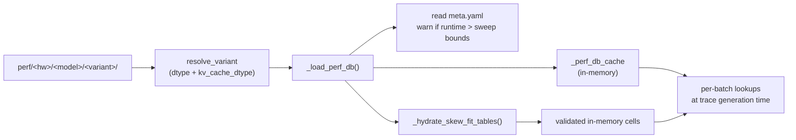

# Output bundle

Each profile run produces a directory tree under
`profiler/perf/<HARDWARE>/<MODEL>/<variant>/`. This is **the contract
between the profiler and the simulator**. Tables must match their schemas,
model geometry and execution contract. Skew calibration retains reference
invalidation checks, and native MoE requires matching semantic deployment contracts;
filenames alone do not establish compatibility.

## Folder layout

```text
profiler/perf/<HARDWARE>/
├── hardware.yaml                 # the card's spec + the measured interconnect;
│                                 # one per hardware folder, shared by every model
└── <MODEL>/<variant>/
    ├── meta.yaml                 # all profile metadata, including per-TP records
    └── tp<N>/                    # one folder per profiled TP degree
        ├── dense.csv
        ├── per_sequence.csv
        ├── attention.csv
        ├── linear_attention.csv  # mamba / gated-DeltaNet models only
        ├── moe.csv               # historical whole-block fallback only
        ├── mtp.csv               # one drafter pass, only with --profile-mtp
        ├── skew.csv              # skew-enabled runs only
        ├── skew_fit.csv          # skew-enabled runs only
        └── moe_components/       # deployment-specific CSVs and optional raw checkpoints
```

`<variant>` uses the established checkpoint label plus explicit activation/KV
suffixes (`bf16`, `fp8`, `fp8-actfp16`, `fp8-kvfp8`, …): see
**[Running → Output naming](./running#output-naming)**. Multiple
variants for the same hardware × model live as siblings. The label is not a
complete resolved-precision record, and alternate variants are not automatically
selected by the simulator; check the naming limitations in the running guide.

`tp<N>/` exists for each TP in `TP_DEGREES`. Layers tagged
`tp_stable: true` in the architecture YAML (layernorms, sampler) are
profiled once at TP=1. The writer **replicates** stable `dense` and
`per_sequence` rows into other TP folders. Stable MTP rows stay in `tp1/mtp.csv`;
the simulator selects TP1 for their lookup.

`hardware.yaml` sits one level up because it answers a different question. The
CSVs are per **(model, hardware)**; the interconnect and the card's memory are
per **hardware**, so one file serves every model bundle underneath. Written by
`python -m profiler hardware`, and read by cluster configs that omit
`link_bw` / `link_latency` / `npu_mem.*` — see
**[Cluster config schema](../reference/cluster-config)**.

## Times are microseconds

All `time_us` columns are in **microseconds**. Ordinary category tables are
converted to rounded nanoseconds at load time. Native MoE component tables retain
microseconds for interpolation, then multiply by 1000 and round the lookup result
to nanoseconds. If you're
hand-authoring CSVs (see [Adding non-GPU hardware](./adding-hardware#adding-non-gpu-hardware)),
remember to use μs.

## CUDA activity and acquisition identity

New ordinary layerwise measurements record a descriptive device-active-union method.
The common PyTorch/Kineto collector records explicit dynamic module scopes and
native CUDA activities without Python stacks, tensor shapes or memory snapshots.
For each raw module invocation, merge overlapping CUDA intervals on the same
device, then apply the existing per-call normalization. Distinct calls remain
separate before averaging, even when their device execution overlaps.
Bindings to raw CUDA kernel names retain the existing sum of matching leaf
durations; they are distinct from a module's per-call interval union.
CPU launch scopes establish ownership only; CPU duration, GPU annotations and
gaps between device activities do not contribute latency. The result is
device-active time, not whole-step elapsed time. Separate catalog components
can still overlap, so adding their costs is not an exact global interval union.

Common direct model methods, declared native operators and explicitly declared
callables can supply additional runtime ownership contexts. An `operator:` binding
selects an exact native CPU operator event, but its cost is the union of its
launch-correlated CUDA activity
intervals, not the CPU event's duration. A `callable:` binding uses the same CUDA
accounting at an exact function/method boundary. Common method contexts remain
context-only; independently measured methods require an explicit callable binding.
All these ownership contexts are transparent to descendants' parent-call
normalization, so adding ancestry does not create extra execution counts.
Missing or ambiguous ownership is rejected; a static module alias is not a
substitute for observed runtime ancestry.

Catalogs may explicitly choose `normalization: parent` or `invocations`; omission
keeps ordinary parent/occurrence normalization and whole-MoE invocation means.
Unavailable callable targets are reported, never stored as zero measurements.
The full architecture includes inactive alternatives, so availability and positive
selected-layout coverage are separate checks. See the
[callable contract](./adding-model-architecture#declared-callable-boundaries).

New category CSVs contain only their coordinate columns and `time_us`, as shown
below. Acquisition metadata lives in the variant-root `meta.yaml`, under
`per_tp[tp].measurements.<category>`. Each entry retains the acquisition `identity`, its
semantic `measurement` token and the observed `acquisitions`. It records the
PyTorch/Kineto collector, per-invocation device-active interval union and
normalization, dummy weights, assigned-page KV preparation, zero-start recurrent
state, deterministic queries and repetitions, together with actual library versions.
Callable and contextual tables keep their structural manifests and completion
records in the same root metadata; those are not extra timing columns or sidecars.

Host/worker agreement and resume compare catalog, contexts, method, geometry and
execution semantics. Exact Torch/vLLM version strings are observational provenance,
not execution vetoes. Historical source hashes remain readable observations;
new admission does not collect source-file digests. Native API, selected backend,
shape, dtype, layout, finite-output and coverage checks still apply. Table hashes
may seal completed data; they are not implementation-version locks.

Historical data keep their original metadata and timing columns. Existing files
without compatible acquisition metadata remain valid historical simulation inputs
where supported, but cannot be extended as a current acquisition. Use a separate
output root or explicitly refresh the category with `--force`; never restamp old
rows. No-op sweeps preserve prior provenance. Compatible additions retain earlier
acquisition observations; TP-stable replication rejects mixed timing methods.

Each new ordinary CSV publication also records
`per_tp[tp].measurements.<category>.publication` with a `state` and `csv_sha256`. The writer
first serializes and flushes the replacement CSV, records the intended checksum
as `pending`, atomically replaces the CSV, then marks that publication `complete`.
Later checkpoints and TP-stable replication use the same ordering. This prevents
an interrupted forced refresh from presenting old CSV bytes as a new acquisition.

Resume checks the saved CSV against its publication checksum. A matching `pending`
record means the saved bytes match the intended generation and can be reused; reading it does
not finalize the record. A mismatched pending or complete record is rejected:
use fresh output or explicitly remeasure with `--force`. Metadata without a
publication record remains readable under its existing compatibility rules and
is not retrospectively stamped by a no-op read. These checks bind saved data to
metadata, not source files or runtime versions, and change no measured timings.
Publication `complete` certifies that CSV generation, not completion of the
requested acquisition grid or any separate category-coverage contract.

Skew uses the same CUDA interval accounting normalized per measured forward.
Root `per_tp[tp].skew` retains its semantic identity, capture contexts, descriptive
method and observed runtime versions; new skew CSVs hold coordinates and timings.
Native DP+EP component bundles retain their separate recorded measurement
contract. The skew fitter's own input/code invalidation rules are unchanged.
Catalog coverage accounts for each native kernel, copy and memset exactly once,
including work outside module scopes. Such work is reported as a gap, not assigned
to a convenient layer or called CPU overhead. Overlapping canonical claims remain
errors visible to the coverage CLI; ordinary measurements reject overlaps within
their category slice before saving. Cross-category overlaps require full-catalog
coverage. Unscoped work requires an ownership-boundary review, not an arbitrary
raw-kernel binding. Coverage is a device-work accounting check, not a latency
union or proof that every declared catalog alternative executed.

Coverage's `canonical_invocations` audit records physical scope calls and
positive-CUDA calls for each explicitly measured forward, with raw-kernel activity
counts kept separate. Each normalization group retains its actual denominator;
do not infer physical calls from that divisor or sum divisors across groups.
Warmup is excluded and missing canonical entries remain explicit. This metadata changes
neither timing values nor the normalization formula.

Every timed forward must contain the same positive active canonical set. Inactive
catalog alternatives need not execute, but a component disappearing in only one
forward invalidates the shot. Warmup validates geometry and finite output outside
timing. A failed check cannot produce a successful acquisition.

Recurrent-only prefixes also verify query/history pairs and their assigned state
pages, including metadata reused between cache groups. With cache mode `none`,
the guard accepts ordinary non-speculative GDN metadata and a separately
native vLLM 0.31 KDA metadata layout. KDA consumes the complete
non-speculative query/state view, including mixed batches' decode prefix, rather
than filling GDN's prefill-only views. Both paths retain query/history, state-page,
initial-state and token-conservation checks; neither changes the native forward.
Unsupported APIs/schemas and active speculative, checkpoint, RecoverSSM or optional
FlashInfer metadata paths fail explicitly. This check is outside timing and alone
does not establish model support; Kimi acquisition has the additional
[native contract](#native-kimi-acquisition) below.
Its preparation semantics belong in acquisition metadata: old rows remain readable,
but an incompatible acquisition cannot resume them by relabeling metadata. MTP
acquisition requires every entry in its category slice: partially captured
drafter work cannot be saved as a complete table.

Both acquisition identities include assigned-page dummy KV initialization through
vLLM's dummy-weight helper. Initialization is outside
timing and is repeated per context. See [preparation and limitations](./running#--measurement-iterations--averaging-out-clock-jitter).

Synthetic requests allocate disjoint physical page spans across all KV groups
from one shared pool, reserving null block 0. Capacity checks include every
group's allocation, not just the largest group. Initialization touches only
assigned spans and respects the backend's block axis and kernel subdivisions.
Typed logical cache views are checked against the engine's shape contract;
the packed formats below have explicit byte-layout checks. Unsupported packed
layouts and state modes fail before acquisition.

Allocation and initialization are described in acquisition metadata. Changes to
their semantics require fresh measurements even if the CSV schema is unchanged. Existing
bundles are not rewritten or certified by this fix; use a separate output root
or explicitly remeasure with `--force`.

Both protocols preserve the prompt/output boundary of history-bearing decode
requests, not just their query lengths and KV positions. This allows vLLM to
select the intended prefill/decode kernels for each mixed batch.

### Dummy model weight preparation

Model weights and dummy KV history are separate inputs. The profiler still uses
vLLM's native floating-weight initialization. On the admitted native
MXFP4/SITU path, it additionally encodes expert checkpoint bytes with the native
MXFP4 quantizer before unchanged native postload processing. A local CUDA
generator supplies BF16 values in `[-0.001, 0.001]`; bounded row chunks use at most
8 MiB of source staging, not a full floating copy of every expert. CUDA and CPU
random streams are not claimed to be identical.

Native KDA's nonpersistent decode buffers are normally filled by checkpoint
callbacks that dummy loading skips. The adapter copies the convolution layout
and FP32 norm from the initialized native parameters, preserving their relation
instead of randomizing the derived buffers independently. These checks and
copies occur outside timed forwards.

The packed path requires the native auto-selected
`DEEPGEMM_MXFP4` backend, BF16 activations and unsharded TP/PP/DP/EP1 without
MTP or offload. Unsupported APIs, backends, layouts or synthetic sharding fail before
publication. Ordinary models call the original loader unchanged; this contract
does not add a universal quantized-weight initializer or complete model support.

An authoritative main engine retains `dummy_weight_preparation` under
`engine_resolved.per_tp`. Its completed initialization and postload-layout checks
do not certify finite forwards, catalog coverage or benchmark accuracy. Those
remain independent acquisition gates. Ordinary and skew method metadata describe
this preparation; incompatible old rows require remeasurement.

### Packed attention history

The NVIDIA vLLM 0.31 acquisition path supports these exact opaque cache formats:

| Format | Payload and scale layout |
| --- | --- |
| `fp8_ds_mla` | Each 656-byte token record contains 512 FP8 NoPE values, four FP32 scales (one per 128 values), then 64 BF16 RoPE values |
| `DEEPSEEK_V32_INDEXER` | Each token contributes 128 FP8 values and one FP32 scale, stored in separate planes within its block; the explicit backend shuffle flag selects plain or 16-by-16 tiled values |

The cache spec, role, dtype, dimensions, block geometry and byte strides must
match the supported format. A `uint8` allocation alone is not enough to infer it.
The indexer's 132 bytes per token are a storage budget, not interleaved
128-byte-value/4-byte-scale records. Null pages, unassigned pages and per-block
padding remain untouched, including when layer views share a backing allocation.

Logical FP8 payloads are initialized as FP16 through the installed
`initialize_single_dummy_weight`, using its unmodified distribution and per-tensor
seed; RoPE payloads use BF16. Native NVIDIA E4M3 quantization then writes the data
and deterministic positive power-of-two scales. For a group maximum `amax`, the
main cache uses `2^ceil(log2(max(amax / 448, 1e-4)))`, while the index cache uses
`2^ceil(log2(max(amax, 1e-4) / 448))`. The distinct clamp positions are intentional.
Scale bytes are neither random dummy values nor arbitrary unit scales.

Floating sources are created in bounded chunks independent of total cache size;
FP32 conversion and quantization intermediates add a bounded multiple of that
source storage. The source-chunk limit is not a peak-memory limit. Initialization
is outside warmup and measured query work. No native forward or trained-weight
KV generation is used; the result is synthetic history, not trained KV statistics
or a guarantee of representative data-dependent sparse selection.

Floating MLA indexer caches use the ordinary typed-cache path. A three-dimensional
`[blocks, tokens, channels]` view may omit the head axis when the spec declares
one KV head and the same floating dtype; shape validation restores that axis
before checking the backend's logical geometry. Existing four-dimensional typed
views remain supported. Squeezed views must also pass a non-overlap stride check:
in ascending stride order, each non-singleton axis starts beyond the extent of
the preceding axes. Padded and permuted views that satisfy this rule are allowed.
This does not relax opaque `uint8` layout checks.
Older runtimes without the sparse-role capability retain the typed path;
this does not enable their unsupported
opaque formats. NVFP4, other packed layouts and ROCm/FNUZ packed acquisition
remain unsupported. Preparation support alone does not certify model catalog
coverage, trace composition or benchmark accuracy. Changed initialization semantics
require remeasurement; a source-file hash alone does not determine compatibility.

## Runtime-selected component layouts

A catalog may declare alternative block decompositions. Qwen supports historical
GDN conv/scan/norm components or a packed native core including the gated norm;
projections and outer glue stay separate. Both use the same GPU-only timing rule.

Positive prefill/decode/mixed CUDA coverage must select a unique variant on every
worker; every acquired shot rechecks it across category boundaries. Model/version
names, CPU events or absent kernels are not evidence. Small probes and acquired
coordinates do not certify unmeasured shapes or backend transitions.

Discovery currently reuses the fixed `_COVERAGE_REGIMES` in
[`profiler/core/runner.py`](https://github.com/casys-kaist/LLMServingSim/blob/main/profiler/core/runner.py).
The engine's token, request, context and cache limits must accommodate those
probes; they are not reduced with the requested grid. An otherwise valid small
engine envelope can therefore fail discovery before category acquisition.
The fixed probes require at least 5 requests, context length 258 and an
acquisition query-token buffer of 68 (logical token budget plus `max_num_seqs`).
The host validates every probe before the first worker call; it refuses an
undersized envelope without resizing or skipping probes. Synthetic batch
assembly also rejects request, token and context overflow before GPU work.

`meta.yaml.component_layouts` is the single authority: schema
`component-layouts`, with a `per_tp` record containing variant selections,
`layout_sha256`, a shared acquisition identity and each affected category's
state/measurement identity. The layout hash binds declarations, choices and
affected catalog bindings, not CSV timing values. Each CSV retains its usual
row-level measurement identity.

| Category state | Meaning | Usable by simulation |
| --- | --- | --- |
| `pending` | Previous acquisition invalidated; no category rows certified | No |
| `writing` | Can resume before the first measured shot or from compatible whole-shot checkpoints | No |
| `complete` | Category finished; saved rows passed layout/identity checks | Only when every coupled category is complete and valid |

Replacement makes `pending` durable before clearing measured rows. Metadata
writers preserve the record rather than inferring completion from file presence.
Unrelated TP-stable replicas retain their original TP1 identities; they do not
establish measured coverage at another degree or become new samples. Replicas
are validated before exemption from local coverage. When a replica-only table
starts local acquisition, its category metadata adopts the local method while
retaining each replicated layer's source-TP acquisition record. Local resume
checks copied rows against that record, not the local measurement identity.
An empty or replica-only
`writing` category can resume, but cannot become `complete`. Readers
reject stale layout contracts, inconsistent row identities, malformed/duplicate
rows, mixed component sets and completed attention/linear-attention tables missing
an entire required regime. This is not a certificate for every grid coordinate.

Unmarked historical bundles keep their old block order and stored timings;
alternative-only rows without metadata are refused. Validated choices and expanded
sequences are cached per TP without mutating the shared catalog. See the
[trace guide](../simulator/trace-generation#runtime-selected-components) for sizing
and communication, which are separate from measured latency.

For the Qwen hybrid catalog, `dense` and `linear_attention` are coupled: removing
the separate norm cost requires acquiring its replacement inside the fused core.
Use a fresh output bundle for a different representation or changed layout
definition. A coordinated forced refresh of historical tables is also possible,
but the bundle is unusable until every affected category completes. See
[resume and force](./running#resume-vs-force) for interruption and refresh rules.

Use one writer per variant bundle, even for different TP/category slices, and do
not mutate a bundle while a simulation reads it. Atomic file replacement and
directory synchronization provide interruption safety, not locking or a live
multi-file transaction. These checks do not establish end-to-end model accuracy.

### Native DSA acquisition

`deepseek_v32.yaml` retains the historical `legacy-modules` representation
and declares `native-eager-tail` for the native DeepSeek-V3.2 path. Selection
requires actual positive CUDA coverage, site invocation counts and runtime
admission; a catalog alias does not extend this contract to GLM-5.

The native sequence replaces fused units together. Its shared embedding endpoint
already includes the first input norm; only absolute target layer 0 consumes that
matching norm prefix. Later norms use invocation normalization. The combined
`dsa_attention_tail` includes sparse indexing and attention, so its history axis
remains **uncapped** even beyond `index_topk`. Historical `attention`/`indexer`
rows are not summed with the new tail or relabeled as it.

The `native-dsa-eager-tail` contract targets the reviewed native vLLM 0.31 path:
original-width FP8 or unquantized BF16 weights with BF16 activations, physical/logical TP1 and EP1,
PP1/DP1, eager execution and decode query length 1. It rejects MTP, offload,
sequence parallelism, shared/skipped indexers, dense-MHA prefill, quantized query
input and unsupported cache geometry. Source-config fields are compared with the
resolved native config, including supported alias/RoPE normalization. Reduced
prefix depth is checked separately, not confused with model width or identity.

The existing per-TP record additionally stores `runtime.runtime_sha256`,
`runtime.invariant_facts` and `runtime.category_engines`. The shared invariant
binds source geometry, backend/cache modes and the actual
native runner/sampler route. The profiler's transparent sampler facade does not
change that route. Its reviewed source determines returned ID width (V1 int32,
V2 int64); this is source-backed metadata, not a tensor-content observation.
Category evidence retains actual reduced depths and cache capacities separately.
Runtime versions are recorded provenance; historical source hashes are not exact-match
execution admission. Actual native APIs, dtypes, layouts and backend modes must
still satisfy the contract.

New publication requires `dense`, `per_sequence` and `attention` to be complete
with matching runtime identities, per-category engine evidence and valid whole
shots. Native MoE components have a separate deployment contract and publication
record; a fresh bundle requires that complete acquisition too, without waiting
for a removed `moe.csv` acquisition. Completing attention alone cannot certify
the head or MoE. Historical records that include a whole-block `moe` category
retain their original completion checks. Compatible interrupted shots resume;
incompatible old rows require fresh acquisition, never a metadata rewrite.
Skew uses the same selected attention components and runtime identity.

These tables currently support only explicit
[duration trace replay](../simulator/trace-generation.md#native-dsa-duration-replay).
The native 656-byte main cache plus 132-byte index cache is not silently passed
to the legacy 708-byte capacity model. This does not certify full-grid coverage,
serving memory feasibility, distributed execution or benchmark accuracy.

### Native Kimi acquisition

`kimi_k3.yaml` selects `native_profile: hybrid-residual`. The shared
`NativeProfile` host orchestration uses an adapter in `hooks/runtime_admission.py`
for the runtime-admitted vLLM 0.31 Kimi-K3 text path: BF16 activations, native
MXFP4/SITU experts, eager execution and local TP/PP/DP/EP1. Backend/ABI checks
and observed layouts remain mandatory; exact library versions and historical
source hashes are provenance rather than execution locks. Removing a fixed
checkpoint or device-capability lock does not certify arbitrary devices or
backends; a catalog alias alone cannot admit another native implementation.

The independently supplied nested configuration defines widths, expert count,
top-k, the decoder schedule and residual block geometry. Shared stack helpers
derive the smallest prefix covering each category's axes. Native MoE acquisition
uses the MLP axis. For the shipped configuration these are four
decoder layers, or two for the MoE slice,
without reducing widths or experts. No fixed checkpoint digest or decoder depth
stands in for validating the supplied configuration and observed runtime.

Ordinary category `slice` commands use the existing grids. Full profiles require
complete ordinary/contextual data and independently published native local MoE
components, including measured wrapper work around the processed MXFP4 experts.
The live adapter must admit the actual backend and capabilities; catalog presence
does not establish support on another device. Explicit local DP1/EP1 selectors
are allowed. Skew and MTP remain unsupported; full profiles require `--skip-skew`.
Historical whole-block measurements remain readable under their original contract.
See the [bounded invocation](./running#native-kimi-profiling). Each TP directory
contains the ordinary CSVs; root `per_tp[tp].categories.<category>` stores its
`contract`, publication `status` and completed `csv_sha256`. Shared `CategoryRecord`
publication binds planned row keys, the whole declared architecture, native runtime,
capture identity, completion status and CSV hash. Loading independently rebuilds
the catalog bindings and requires every binding at each recorded coordinate;
completion does not claim unmeasured coordinates or a full production grid.
Malformed, ragged or duplicate partial rows are refused before preload or
deduplication. An incomplete shot is remeasured as a whole. A completed table with
changed data or incompatible semantic bindings is refused. Runtime versions are
recorded per acquisition, not compared as exact execution-admission constraints.
Changed execution semantics require fresh measurements in a separate output root
or an explicit remeasurement. Historical metadata has narrow read fallbacks;
relocation alone neither remeasures timings nor relabels an incomplete acquisition
as successful.
Dummy-weight preparation elapsed times remain telemetry in engine metadata, not
execution invariants or GPU latency inputs. The intended scope is bounded native
acquisition and saved-duration trace replay. Fresh GPU validation is required
before claiming coverage for a new bundle; TP2, full profiling, native capacity
admission and end-to-end benchmark accuracy are not established by this adapter.

Two boundaries need particular care:

- **MLA:** the q-LoRA phase joins native attention and gate work that may execute
  concurrently on separate streams. Its measured device interval union is one
  `attention` component; the gate application and output projection are separate
  dense components. Adding separate costs for the concurrent branches would
  double-count their overlap.
- **AttnRes:** original layer position changes the number of residual blocks and
  optional inputs. A reduced engine cannot measure every original-stack context.
  The dense pass therefore calls the unchanged native AttnRes function separately,
  with ordered roles and structural contexts derived from the supplied depth,
  residual block width and source schedule at each dense token point. This does
  not execute the full original model on the GPU.

Root `per_tp[tp].contexts` holds `ordinary` and `callables` context records, each
with its contract and completion receipts. `per_tp[tp].callables.callables` holds
acquisition `options`, the explicit residual `plan` and token-keyed `shots`.
Options retain the selected profile, tokens, iterations, warmups and runtime
versions. The plan retains workloads, catalog, contexts and semantic stamps;
compact shot summaries bind scope, measurement stamp, CSV-shot checksum, call
counts, native kernel routes and device observations.

`tp<N>/callables/dense_context.csv` still stores context-specific microseconds.
Full native CUDA ledgers are validated during acquisition, not saved as new
per-token evidence JSON files. Historical sidecars remain read-only fallbacks.
The generic collector
is the same lightweight PyTorch/Kineto path; no CPU scope duration enters the
table. Explicit finite synthetic tensors supply the standalone function's inputs;
native API, shape, strides, optional inputs and physical invocation counts are checked.
Allocation is bounded to 512 MiB of declared input tensors per shot, with at most
16 timed iterations and four warmups. Larger plans fail before engine startup.

`ContextualProfileBundle` in `serving/core/component_sizes.py` requires every
category and residual context to be complete and compatible with the independently
loaded source configuration. Callable receipts bind compatible runtime semantics
and the validated per-shot summaries to the saved timing rows. Ordinary
tables retain their existing interpolation. AttnRes uses an
immutable context lookup and linear interpolation in tokens **within that exact
context**; it neither searches neighboring contexts nor extrapolates beyond the
measured token range. This supports [local duration replay](../simulator/trace-generation#native-kimi-duration-replay),
not resident-memory admission, whole-workload accuracy or CUDA-graph equivalence.
Coverage still reports unscoped runner GPU work, including input/state updates
and host/device copies, separately from these layer components. It can therefore
exit nonzero even when all declared model boundaries executed. Do not suppress
those gaps or interpret model-boundary coverage as complete step-time accounting.

## Native attention lookup contract

New MiniMax-M3 attention acquisitions record
`meta.yaml.attention_lookup` with schema `native-attention-lookup` and an
independent `per_tp` record for each measured TP. This is acquisition-owned
backend evidence, not a user-supplied cap or a reinterpretation of old data.

The supported contract checks the native **vLLM 0.31.0 NVIDIA Triton** pair
`MiniMaxM3IndexerTritonImpl` / `MiniMaxM3SparseTritonImpl`, using BF16 indexer
and attention KV storage, max-score selection, and a contiguous int32 selection
buffer whose width equals the configured `sparse_topk_blocks`. The reviewed
layout requires **128 tokens per block**. Initial/local blocks occupy the
selected-block total; they do not enlarge it. Acquisition inspects the actual selected objects,
buffer layout, callable API and model/catalog parameters, and requires semantic
worker agreement. Observed versions and any historical source hashes are provenance,
not execution locks; new acquisition checks the actual API and layout. Another
implementation, layout, storage precision or speculative
path needs a separately reviewed contract; a matching
model name or version label alone is insufficient.

The resulting `sparse_topk_blocks × sparse_block_size` cap (**2048** for the
shipped configuration) applies only to `sparse_attention` prefill lookup:
cap each request's effective key before taking the query-weighted mean. Dense
attention and the indexer remain uncapped, as do decode-history coordinates.
Producer rows keep their raw coordinates and measured timings, including above
the cap; those rows still describe real acquisition work, not the chosen lookup
anchor. A cap does not assert identical latency at every larger history.
It is also separate from logical trace-byte accounting and physical KV capacity.

Each per-TP record contains `semantic`, its `semantic_sha256`, the ordinary
`measurement` identity, `completed`, and `attention_sha256`. Acquisition metadata
binds the semantic digest while CSVs retain coordinates and timings. Publication
marks the record pending before
accepting rows and seals the completed attention CSV. Consumers reject pending
records, unknown schemas, missing metadata for marked rows, altered checksums,
mixed identities, or model/catalog/TP mismatches. Completion describes the
selected acquisition plan, not proof of a full grid or arbitrary context range.

The reader accepts current measurement metadata and explicitly supported
historical row protocols. This does not make acquisition identities interchangeable:
semantic contracts and completion seals must still match. Source-file changes or
an exact version difference alone are not a veto. Reading a historical protocol
never rewrites or upgrades its stored rows.

Unmarked historical tables retain their existing lookup semantics: **2176**
for the shipped MiniMax-M3 configuration. Do not add a contract to historical
rows, rewrite their keys or automatically change their timings/fits. Use a fresh
root, or explicitly remeasure incompatible attention data. A compatible resume
reuses rows without timing them again; interrupted native publication must be
resumed before consumption. Unrelated category refreshes preserve the contract.
Keep one writer per variant root and published bundles immutable.

Serving, skew fitting, support completion and `plan-skew` share the per-TP
resolver. Native skew rows bind the same semantics and require a matching
completed root `per_tp[tp].skew` record and table checksum before fitting. A zero-case skew plan creates
no new skew file or completion claim, does not itself trigger a fit, and leaves
existing artifacts intact,
even with `--force`; it contributes no new skew provenance. Other nonempty TP
acquisitions are still recorded.

The bounded native validation covers TP1 BF16 prefix acquisition on SM120 and
consumer behavior around the selection boundary. It does not establish full-grid
coverage, multi-TP deployment, model-capacity admission or end-to-end benchmark
accuracy. Inspect the actual bundle's plan and measured support before use.

## `dense.csv`

```
layer,tokens,time_us
act_fn,1,4.21367
act_fn,2,5.36533
...
qkv_proj,1,20.4373
qkv_proj,2,20.4813
...
```

| Column | Meaning |
| --- | --- |
| `layer` | Canonical layer name (must match the architecture YAML's catalog) |
| `tokens` | `total_len` for this shot |
| `time_us` | Measured kernel latency, microseconds |

The simulator does **1D linear interpolation over `tokens`** when
looking up.

Layers it covers: `embedding`, `layernorm`, `qkv_proj`, `qk_norm`,
`rotary_emb`, `o_proj`, `gate_up_proj`, `act_fn`, `down_proj`,
`final_layernorm`. (Anything in the YAML's catalog with category
`dense`.)

DeepSeek/GLM `indexer_glue` measures only residual work outside the indexer's
`LayerNorm` and `SparseAttnIndexer` subtrees. Their copy/fill kernels already
belong to `indexer_k_norm` and `indexer`; wildcard kernel bindings must not
charge them a second time, including when profiling the dense category alone.
Refresh older glue rows with `profiler slice --group dense --force` for the
affected bundle. Updating the catalog does not rewrite stored latency tables.

## `per_sequence.csv`

```
layer,sequences,time_us
lm_head,1,1075.13
lm_head,2,1044.52
...
sampler,1,25.9333
...
```

| Column | Meaning |
| --- | --- |
| `layer` | `lm_head` or `sampler` |
| `sequences` | `num_requests` for this shot (decode rounds operate per-sequence) |
| `time_us` | Measured kernel latency |

Simulator: **1D linear interpolation over `sequences`**.

## `attention.csv`

The attention table covers pure-prefill, pure-decode, and mixed
kernel shapes:

```
layer,prefill_chunk,prefill_key,n_decode,kv_decode,decode_q_len,time_us
attention,0,0,1,16,1,8.08533
attention,0,0,1,32,1,8.17033
...
attention,512,2304,4,128,1,...
...
```

| Column | Meaning |
| --- | --- |
| `prefill_chunk` | Tokens of the prefill chunk in this iteration. `0` = pure decode |
| `prefill_key` | Query-weighted effective causal key length across prefills |
| `n_decode` | Number of concurrent decode requests in this iteration. `0` = pure prefill |
| `kv_decode` | KV cache history length the decode requests attend to |
| `decode_q_len` | Query tokens per decode sequence; normally 1, larger for speculative verification |
| `time_us` | Measured attention kernel latency |

For chunks `c_i` with histories `k_i`, the shared profiling/runtime coordinate
is `sum(c_i * (k_i + c_i / 2)) / sum(c_i)` (zero without prefills). Equal
chunks and single-request shots keep their previous values. Legacy
`kv_prefill` tables held one prefill per shot and are relabelled on load as
`kv_prefill + prefill_chunk / 2`; this does not create missing grid coverage.

The simulator selects the table for the requested `decode_q_len`, then uses
**4D linear interpolation** over the remaining shape axes. An unprofiled query
length selects the nearest available query-length table with a warning; it is
not interpolated. Profile the query lengths needed by the intended deployment.
Within that table, coordinates are bracketed and blended on a linear scale,
even when measurement points are geometrically spaced. Queries below an axis
minimum are clamped, and those above its maximum extrapolate from the top two
samples. Missing prefill-token/decode-count corners use the nearest available
corner before the blend.

This lookup does not round batches up to a profiled size. CUDA graph padding
is a separate [execution-shape contract](../simulator/parallelism-mechanics),
and the simulator's attention lookup retains the real query/KV lists. It does
not separately represent FULL-graph padded attention metadata/empty-slot cost;
see the [per-layer graph contract](../simulator/parallelism-mechanics#which-layers-see-graph-padding).
When enabled,
[skew calibration](./skew-alpha-fit) selects a compiled alpha bucket to correct
the mean-KV estimate toward the maximum-KV estimate; alpha itself is not
interpolated between neighboring buckets.

The base grid is geometric, controlled by `--attention-chunk-factor`,
`--attention-kv-factor` and `--attention-n-factor`. Read the CLI's `--help`
for current defaults; the editable `profile.sh` supplies explicit overrides.
Applicable pure-regime slices also include target serving graph anchors:
FULL-capable decode points at each selected query length, and prefill points
only for `FULL`. Mixed shots keep their geometric axes. These remain eager
measurements; see [sampling policy](./running#sampling-policy).
The KV factor controls two axes. Smaller factors increase the Cartesian
product of measurements, not just one additive set of points. Finer sampling
does not guarantee better end-to-end accuracy; compare completed bundles using
the same benchmark reference. See [cost planning](./running#expected-runtime).

## `linear_attention.csv` (mamba / gated-DeltaNet models only)

| Column | Meaning |
| --- | --- |
| `layer` | Canonical layer name |
| `prefill_tokens` | Tokens in the batch's prefill chunk |
| `n_decode` | Number of decoding sequences |
| `time_us` | Latency for one trace node, microseconds |

Two axes rather than attention's four, and no kv axis at all: a
gated-DeltaNet layer keeps a fixed-size conv state and a fixed-size recurrent
state per sequence, neither a function of position. Cost therefore does not
depend on sequence length — measured on Qwen3.8-27B, a 64x spread in kv length
moves it 1.1% — and **no skew correction applies**, unlike `attention.csv`.

Two axes rather than one because *which kernel runs* depends on the mix. A
pure-decode batch runs a recurrent kernel; add a prefill chunk and vLLM
switches to a fused-gating one, and the conv switches too. That is why this
file, like `attention.csv`, includes a `layer` column: one block can run
several non-interchangeable kernels on the same axes, so each gets its own
rows, and a cell is empty when the batch shape never reaches that kernel.

This describes the historical separate-kernel decomposition. A catalog with a
[recorded component layout](#runtime-selected-component-layouts) may instead emit
one fused-core row on these axes, with corresponding changes to its coupled
`dense.csv`. Do not mix representations or infer a new choice from row names.

The `prefill_tokens` axis is sampled **chunk-aware** — inside the first chunk,
at every chunk boundary, and at the token just past each boundary. Cost is a
staircase, not a line: one token past a 64-boundary costs 13.5% more than the
boundary itself, and the interval to the next boundary is nearly flat. A plain
geometric grid lands only on boundaries, so interpolating between two samples
underestimates most of the token counts a chunked-prefill scheduler actually
produces.

## Native DP+EP components

Native MoE acquisition defaults to DP1; `--dp` selects other target degrees.
Optional `--ep` filters the supported TP*DP targets without changing their geometry.
It publishes root `per_tp[tp].moe_components` metadata
and deployment-specific `components.csv` tables. Contracts and coverage live in
that root record, not standalone index/contract/coverage JSON files.
Conditioning coverage is a compact count and maximum-change summary; individual
control coordinates and timings stay in raw resume checkpoints. Publication still
requires the configured quality checks and preserves the completed table checksum.
These are separate from the legacy whole-block `moe.csv`: local gate/routing,
gathered experts and local finalization have different token domains and
eager measurements. New acquisition does not capture isolated CUDA graphs.
Historical tables retain their recorded modes. Global expert count and top-k are preserved.
Modular DP1 records only `gate_routing` and `experts`, with verified identity preparation
and aliased no-op finalization in `contract.local_execution`; no synthetic copy
or zero-latency row is stored. Target-specific backend selection is retained.
The separate live TP1/DP1/EP1 contract records `gate_routing`, `experts` and
`wrapper`. It preserves native processed weights, backend and expert prepare/finalize
work; the wrapper retains shared experts, latent transforms and combination work
after excluding gate/router and routed-kernel activities. Exact native-method
references and unchanged state are required outside timing. The metric is a sum
of unique CUDA activity durations, not overlap-aware elapsed latency.
Recorded gate dtype/width can differ from expert width. Physical expert weight
bytes and cloned-bank allocation bytes are distinct, with wrapper weights counted
outside gate/expert storage. The isolated engine's private KV-memory cap preserves
requested limits and requires native capacity validation; its actual settings stay
in the MoE contract's observations, never replacing main-engine cache facts.
New expert tables sample physical tokens N, active local experts A and local
assignments M using `--moe-grid-factor` (default `2`) and mandatory feasible
geometry corners. The recorded `expert_sampling` contract identifies these axes
and their spacing, plus local/expert token anchors transformed from target
serving graph coordinates. `capture_tokens` holds those anchors;
`geometric_token_ranges` holds uncovered local/expert intervals (empty means
capture-covered, absent preserves an existing plan). `logical_token_budget`
retains the requested limit; `local_token_budget` in the contract includes any
MRV1 compiler-SP rounding needed for the physical buffer.
Endpoints and feasible corners remain part of the plan. `sampling_graph` records
the capture source; capture
sizes do not determine active experts or assignments. The simulator
precomputes Delaunay support at load time and caches barycentric interpolation
in physical coordinates, using at most four measured rows per query. It fits no
latency predictor. Historical balanced-assignment tables retain their existing
lookup. The live contract admits quantized/shared execution by actual capability;
unsupported layouts or deployments are rejected rather than mapped to an old table.

Matching tables are selected automatically, with deployment, dtype, coverage
and checksum validation. Missing coverage can use legacy fallback only when a
historical whole-block table exists; fresh bundles require complete matching
components. See [Native MoE components](./native-moe-components)
for the full schema, raw repetitions, resume and unsupported-path behavior.

## `moe.csv` (legacy whole-block MoE profiles)

```csv
ep,tokens,activated_experts,time_us
1,1,8,47.8
2,1,4,36.1
4,1,2,30.2
```

| Column | Meaning |
| --- | --- |
| `ep` | EP degree used by the legacy expert/top-k-shrunk acquisition |
| `tokens` | Input rows presented to the profiled rank; the AgRs consumer uses gathered rows |
| `activated_experts` | Distinct experts touched on that rank |
| `time_us` | Measured whole-block latency in microseconds |

These are historical measurements. Whole-block acquisition, expert/top-k slicing,
forced routing and `--moe-ep-degrees` have been removed. A new
`slice --group moe` measures native components at DP1 by default and does not
rewrite `moe.csv`; native contracts require a fresh output root to remeasure.

The legacy consumer retains two-dimensional interpolation over tokens and active
experts within an EP grid. An unprofiled EP degree falls back to the nearest
with a warning. A bundle without the EP column is read as EP1.

The old acquisition changed the checkpoint expert/top-k shape to approximate a
local rank. Its EP column does not establish native global-top-k routing,
DP/backend coverage or separate local and gathered measurements. Existing files
remain readable until supported components are remeasured, with warnings for
unverified DP coverage. Stored timings are neither corrected nor relabelled by
a code or metadata update. Unsupported native acquisition fails explicitly;
there is no whole-block acquisition fallback.


## `skew.csv` (skew-enabled runs)

One measured target per attention kernel and ordered request shape.

| Column | Meaning |
| --- | --- |
| `layer` | Exact attention-category kernel |
| `requests_json` | Ordered query/history pairs |
| `n_prefill`, `decode_q_len` | Explicit query roles |
| `case_id` | Geometry-derived key |
| `round_timings_us_json` | Individual forward times, grouped by context |
| `t_skew_us` | Median of the context-level forward medians |

Acquisition families, method identity, resolved block size, repetition counts
and runtime observations live in root `per_tp[tp].skew`. Historical CSVs may retain
these columns; new acquisitions do not repeat them on every timing row.

Historical bimodal rows can be reconstructed; general distributions need
their full request lists. Measured controls, when present, remain diagnostics.
The compiler obtains mean/max references through the unchanged serving
attention lookup, never by relabelling measured control values.

Kernel ownership is verified through native CUDA launch correlation IDs and
the innermost launching CPU module scope, after mapping profiler thread
identities to native OS threads. This can repair misplaced CUDA leaves in
the upstream profile tree without shifting timestamps, changing GPU durations,
or adding CPU overhead. Missing or ambiguous launch ownership rejects the shot.
Method metadata describes this attribution and aggregation; older rows remain
historical measurements, not completed current acquisitions.

Root `per_tp[tp].skew` records new acquisitions with the actual per-TP plan,
resolved page size/capacity, seed, family counts and completion status.
Interrupted or failed runs retain an incomplete status and checkpointed rows.
If the final rows were saved but the completion update was interrupted, resume
validates the completed plan and seals its record without measuring again or
adding acquisition provenance.

## `skew_fit.csv` (skew-enabled runs)

New fits use `runtime-skew-calibration` and write:

```text
layer,decode_q_len,pc_label,lev_label,n_anchor,alpha,direct_rows,pooled_rows
```

| Column | Meaning |
| --- | --- |
| `layer`, `decode_q_len` | Separate kernel/query slice; no cross-slice borrowing |
| `pc_label`, `lev_label` | Prefill-token and relative-reference-gap partition |
| `n_anchor` | Measured decode count with enough direct support in this partition |
| `alpha` | Clipped relative-latency weighted median |
| `direct_rows` | Distinct supported cases at the anchor itself |
| `pooled_rows` | Direct cases plus nearby unsupported-N cases pooled into this anchor |

The simulator picks the nearest supported N on a log scale, with lower-anchor
ties. It does not interpolate neighboring alpha values. The support-adaptive
N anchors differ between partitions; prefill cutoffs scale with the measured
prefill envelope and leverage cutoffs are dimensionless.
See [Skew & alpha fit](./skew-alpha-fit) for the objective and fallback rules.

Each `meta.yaml::skew_fit.per_tp[tp]` entry records the schema, bundle/TP
identity, `axes`, `min_rows`, `alpha_clip`, `n_samples`, dropped-row counts,
`alpha_default_by_kernel`, `n_range_by_kernel`, `reference`, `bucket_table`
and `bucket_table_sha256`. Kernel/query keys have the form `attention|q=1`.
`reference` records attention and raw-skew checksums, the lookup fingerprint
and key-saturation semantics. The fitted CSV contains the cells, not raw shots.

The lookup fingerprint covers batch-context construction as well as attention
lookup. A head-row change can therefore invalidate a fit without changing its
attention reference values. Run the CPU-only `profiler refit-skew` command to
refresh the bundle, rather than replacing fingerprints manually. A successful
refit can leave all numerical CSV values unchanged.

Legacy files have `layer, n_label, pc_label, lev_label, alpha, n_samples`
and no schema field. They are no longer accepted when skew is enabled:
run `profiler refit-skew` first. Disabled bundles do not read these tables.

## `meta.yaml`

Sibling of the `tp<N>/` folders and the only metadata document written for a
new profile bundle. `per_tp[tp]` owns measurements, category publication,
context/callable records, skew acquisition and native MoE entries. Already-central
engine, attention-lookup, component-layout and calibration sections retain their
existing locations and separate authority. Updates preserve unrelated records
through the shared strict metadata reader/writer. Moving metadata between
locations does not alter numerical behavior; adopting a different serving graph
policy can alter simulated execution shapes. Metadata writes are serialized
under an empty `.meta.lock`; this lock file is synchronization, not measurement
metadata. It does not make concurrent acquisition into one table safe: honor each
acquisition path's writer exclusion and do not change a bundle while it is being read.

Historical sidecars have narrow read fallbacks, not new write destinations;
`skew.meta.yaml` is no longer loaded.
Optional raw repetition checkpoints support acquisition resume; failure-only
diagnostic records can support debugging. Neither is required to load published
timing tables, and neither replaces the root metadata contract.
Moving existing metadata preserves its observations and timing-table bytes;
it does not certify a fresh acquisition. This schematic omits generated hashes;
use the profiler to create enabled entries, not hand-written placeholders.

```yaml
hardware: RTXPRO6000
model: Qwen/Qwen3-32B
variant: bf16
per_tp:
  '2':
    measurements: {}  # category identities, observations and CSV publication seals
    categories: {}    # native category contracts, status and completed CSV hashes
    contexts: {}      # ordinary/callables contracts and completion receipts
    callables: {}     # callable options, plans and compact per-shot summaries
    skew: {}          # actual acquisition plan and completion, when acquired
    moe_components: {} # deployment entries with contracts, coverage and table paths
engine_resolved:
  per_tp:
    '2':
      block_size: 16
      max_model_len: 40960
      num_cache_tokens: 43523488
skew_fit:
  enabled: true
  per_tp:
    2:
      schema: runtime-skew-calibration
      identity: {hardware: RTXPRO6000, model: Qwen/Qwen3-32B, variant: bf16, tp: 2}
      estimator: supported_n_relative_latency_l1
      min_rows: 20
      bucket_table: tp2/skew_fit.csv
      # axes, fallbacks, measured ranges and fingerprints are compiler output
```

### `serving_execution`

Serving graph observations are separate from eager acquisition settings. The
benchmark records completed worker startup under `meta.json.execution`; import
it explicitly into an existing bundle:

```bash
python -m profiler import-execution Qwen/Qwen3-32B --hardware RTXPRO6000 \
  --bench-dir bench/results/my-run
```

The root `serving_execution` list keeps one current observation per deployment
scope, not an execution history. Each entry records the effective runner/mode,
complete base and actual FULL/PIECEWISE capture sizes, compiler sequence
parallelism, graph implementation, model configuration, device and precision.
Scope includes TP/PP/DP/EP, scheduler limits, speculative token count, block size,
maximum model length, chunked prefill and prefix caching. Runtime version and
timestamp are provenance, not locks. The importer checks model/device/precision
compatibility and does not accept reduced-model or perturbed diagnostic runs as
full-model references.
When a local model declaration is available, workers resolve it through their
installed native configuration class before comparing it with the effective
model. This handles renamed fields and nested RoPE parameters without an offline
model-specific alias list. Only the compact declaration is retained after a
match. A custom variant label requires explicit matching acquisition dtype and
KV dtype; its name alone is not a precision contract.

An explicit instance `cudagraph` object wins. Otherwise the simulator uses a
scope-matching observation, or derives its historical defaults; an incompatible
saved observation warns before fallback. Worker observation currently supports
the fixed-query MRV2 contract without LoRA, DBO or context parallelism. Unsupported
or incomplete startup, conflicting workers and partial rank coverage remain
`unknown` and cannot be imported. Frontend requested settings alone are not proof
of worker capture. Observing all DP engines requires collecting their individual
responses rather than retaining only the load-balancing client's first result.

Import changes no latency CSV or acquisition method. Graph-shaped axes do not
certify eager timings as graph timings: attention capture metadata and kernel
selection can differ even with the same real requests. This metadata supports
dispatch modeling; matched timing validation remains separate.

### Identity and provenance

Stored symbolic method, policy and format labels use descriptive hyphen-separated
names, without old-name aliases. Remeasure obsolete method contracts in a separate
output root rather than relabeling them. Legacy file-layout fallbacks still require
current method contracts; unmarked historical mainstream tables remain readable.
Numeric structural schemas and actual library/model versions are unchanged.

| Key | Meaning |
| --- | --- |
| `profiler_version` / `vllm_version` / `cuda_version` | Versions the bundle was produced with. Kernel timings shift a few percent across CUDA driver versions, so this is the field to check before trusting a mixed comparison |
| `gpu` | The **driver's** device name, verbatim |
| `hardware` | The `--hardware` label, i.e. the folder name and the value a cluster config's `hardware` field must match. Distinct from `gpu` |
| `architecture` / `architecture_sha256` | Which `profiler/models/*.yaml` was used, and its hash — so you can tell whether a catalog edit invalidates the bundle |
| `model` / `variant` / `tp_degrees` | What was profiled |
| `measurement_iterations` | Timed forwards averaged per shot |

### `engine_effective`

The engine kwargs vLLM actually ran with, not what was requested.
Notable entries:

- `max_num_batched_tokens` / `max_num_seqs` — the **logical** values.
  The engine is booted with `max_num_batched_tokens + max_num_seqs` for
  shot-bypass headroom, and the bump is subtracted back before
  recording, so what you see here is the sweep bound.
- `hf_overrides` — the overrides still forwarded after local config
  materialization, not a complete inventory of effective model fields.
  Nested backbone-only fields, including reduced depth and per-rank shapes,
  are written into `text_config` and consumed before calling vLLM. Root-only
  and shared root/text keys remain forwarded. Flat model overrides are unchanged.
  Category engines retain every block type they measure; hybrid stacks are
  not universally reduced to one layer.
- `load_format: dummy` — checkpoint weights are not loaded. Synthetic weights
  support shape-controlled acquisition, not equivalence to trained routing or
  KV contents; see the measurement contracts above.
- `model` — the tmpdir the model config was written to, so vLLM needed
  no Hub access. The path is dead after the run.

An empty `hf_overrides` does not mean the original full-depth model ran. Consumed
values are applied in the temporary local config; their resolved text fields
are retained separately under `engine_resolved`, below. A configuration fix does
not certify new backend coverage or migrate existing tables; incompatible
acquisition resumes remain rejected.

Explicit `dtype` and `kv_cache_dtype` engine arguments are retained here when
passed. Their absence means vLLM's defaults were used, not that a particular
dtype was resolved. A quantized model can record `dtype: bfloat16` while keeping
FP8 weights. Check these arguments, the source config and any recorded runtime
facts together; `variant` alone does not encode every effective dtype.

### `engine_resolved`

`per_tp[tp]` retains the engine's `block_size`, `max_model_len` and
`num_cache_tokens`. New authoritative main-engine records also include
`model_text_config`: a deep-copied snapshot of the native resolved text config,
including reduced depth, per-rank fields and consumed nested overrides. The
snapshot survives deletion of the temporary config directory. It is not the
multimodal wrapper config, backend selection or a parameter-layout inventory.

A refresh updates only the recorded TP entries. MTP and non-authoritative
short-stack engines do not replace main-engine snapshots. Older limits and
metadata without a snapshot keep that absence; missing values are not
reconstructed from today's config. Read the source and engine arguments with
these facts rather than treating the snapshot as full execution provenance.

### Grid specs are compact, not enumerated

`attention_grid.decode_q_lens` lists the requested decode query lengths.
Row counts alone do not establish that coverage. Pure-prefill rows are emitted
once at `q=1` regardless of the requested decode query lengths, so their presence
does not establish ordinary `q=1` decode coverage.

`category_provenance` records the vLLM version and timestamp **per category**.
A bundle is not necessarily one measurement session — a `slice` refresh
rewrites one category and leaves the rest — and the top-level `vllm_version` /
`profiled_at` describe only the most recent refresh. Which rows came from which
version is not a detail: vLLM 0.28 restructured MoE, and the two versions agree
to within noise on decode-sized batches while differing by 16–26% at 2048
tokens.

A refresh only rewrites what it measured. `engine_effective` and
`engine_resolved` describe the **deepest main engine**. An ordinary category
slice updates them for its selected TP when its required depth equals the
all-axis depth. A shallower slice or an MTP slice preserves them; the drafter
engine has different cache requirements. `attention_grid` may only be rewritten
by a run that swept attention.

`attention_grid` uses a shorthand rather than
listing every point:

| Spec | Reads as |
| --- | --- |
| `0, 16-2048 x2` | the value `0`, then `16` doubling to `2048` |
| `2-256 x2` | `2` doubling to `256`, no zero point |
| `[0.0625, 0.125, …]` | an explicit list, used where the axis is not geometric |

The root `per_tp[tp].skew` record retains explicit dynamic acquisition axes,
resolved limits and completion. Older root summaries may remain historical
records, but acquisition, refitting and lookup do not load `skew.meta.yaml`.
Current repeat-level skew data requires complete root acquisition metadata;
unmarked historical skew tables retain their existing behavior.

### Sampling plans

Root `per_tp[tp].sampling[category]` records ordinary acquisition plans: eager
execution, geometric factor, feasible shot count and applicable target graph
coordinates. Targets record runner, mode, query length, TP/DP, capture sizes
and their source: `observed worker capture`, `explicit target options` or
`derived capture candidates`. Derived plans retain assumptions and acquisition
backend capability scope; an unmatched observation records its fallback reason.
TP-stable forward anchors are recorded when TP1 supplies multiple TP degrees.
Excluded dense capture coordinates are reported when runtime bounds prevent
their measurement.

Attention records its independent factors and pure-regime anchor restriction.
Per-sequence metadata states that logits and sampler use actual output rows
outside the graph. MTP records request anchors and the missing first-pass
query/token dimension. Native MoE records `sampling_graph` and transformed
`expert_sampling.capture_tokens` in each deployment contract. Skew retains its
independent acquisition plan.

A sampling plan describes requested feasible coordinates, not completed rows
or graph capture by the acquisition engine. Completion and integrity remain
the responsibility of each category's publication records. Sampling changes
do not relabel historical measurements as graph timings.

### What the simulator actually reads

| Key | Used for |
| --- | --- |
| `engine_effective.max_num_batched_tokens` / `.max_num_seqs` | One-shot warning when the runtime CLI exceeds the sweep bounds, since lookups will extrapolate |
| `skew_fit.enabled` | Whether to apply any skew correction at all |
| `attention_lookup.per_tp[tp]` | Validate native attention semantics, row identity and completion checksum; select the matching TP's sparse-prefill cap |
| `skew_fit.per_tp[tp].schema` | Required `runtime-skew-calibration` format |
| `skew_fit.per_tp[tp].identity`, `.reference`, `.bucket_table_sha256` | Validate bundle identity, attention/reference implementation, saturation contract and table bytes |
| `skew_fit.per_tp[tp].axes`, `.bucket_table` | Load partitions and supported N anchors once |
| `skew_fit.per_tp[tp].alpha_default_by_kernel`, `.n_range_by_kernel` | Same-kernel/query fallback and measured N bounds |
| Legacy inline alpha / bucket-axis fields | Not supported for enabled calibration |

Other version and acquisition fields describe provenance. Raw skew data is
required for rebuilding, not for runtime lookup. A changed attention table,
lookup implementation, fitted table or saturation contract invalidates new
calibration and requires `profiler refit-skew`.

## How the simulator consumes this



For the simulator-side mechanics, see
**[Simulator → Trace generation](/docs/simulator/trace-generation)**.

## Gotchas

1. **Don't edit CSVs by hand to "tune" simulation results.** The
   simulator interpolates linearly across rows; bogus values produce
   non-monotonic behavior that's hard to debug.
2. **`time_us` is microseconds.** A common mistake when synthesizing
   CSVs from external tools is to put nanoseconds. Triple-check.
3. **Layer names in `dense.csv` must match the architecture YAML.**
   If you add a layer to the YAML and don't profile it, the
   simulator one-shot-warns (and uses 0 latency for that layer,
   silently corrupting results). Re-run profile after YAML edits.
4. **`tp<N>/` folders aren't symlinks.** TP-stable layers are
   physically copied by the writer. Editing `tp1/dense.csv` doesn't
   propagate to `tp2/`.

## What's next

- **[Skew & alpha fit](./skew-alpha-fit)**: methodology behind
  `skew.csv` and `skew_fit.csv`.
- **[Adding non-GPU hardware](./adding-hardware#adding-non-gpu-hardware)**
  synthesize this CSV bundle from your own measurement source.
