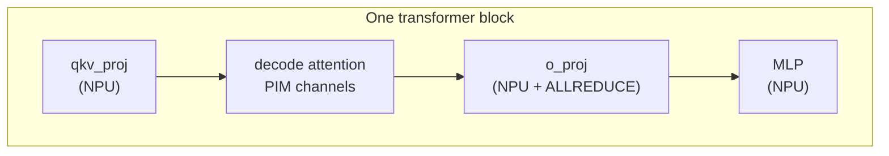

# PIM offload

Processing-in-memory (PIM) puts compute units physically inside DRAM,
turning a traditionally memory-bandwidth-bound kernel into a
compute-on-data-path operation. LLMServingSim models PIM as a
separate device that can take over **decode attention**. Prefill attention
and the rest of the layer still run on the GPU.

This page describes how the PIM path lives inside the simulator. The
*configuration* angle (what flag to pass, how to wire up a PIM
device in the cluster config) is on
**[Examples → PIM attention offload](/docs/examples/disaggregated/pim-attention-offload)**.

## What gets offloaded, and what doesn't

When `--enable-attn-offloading` is on:

| Layer | Where it runs |
| --- | --- |
| `embedding`, `layernorm`, `qkv_proj`, `qk_norm`, `rotary_emb` | NPU |
| `attention` for decode requests | **PIM** |
| `attention` for prefill queries | NPU |
| `o_proj`, `gate_up_proj`, `act_fn`, `down_proj` | NPU |
| `final_layernorm`, `lm_head`, `sampler` | NPU |
| MoE block (if applicable) | NPU |

So only decode attention compute moves to PIM. The KV cache for attention
moves with it, KV blocks live in PIM memory rather than NPU memory,
which frees up NPU memory for weights or larger batches.

Token streams cross from NPU to PIM via memory writes (input
activation), then from PIM back to NPU via memory reads (attention
output). These crossings are modeled as memory transfers in the
trace.

## How it shows up in the trace



`trace_generator._emit_sequence` walks the architecture YAML's layer
list. When it sees an `attention` layer **and**
`enable_attn_offloading=True`, it emits PIM blocks for decode work and
retains the NPU attention kernel for any prefill queries:

```text
... qkv_proj_3 ... (NPU)
PIM 0
attention_4      (PIM device, modeled decode latency)
PIM END
... attention_6 ... (NPU, when prefill queries are present)
... o_proj_7 ... (NPU, ALLREDUCE if TP > 1)
```

The `PIM 0` / `PIM END` markers tell the Chakra converter that the
contained operation runs on the PIM device with channel 0. The
converter emits a `COMP_NODE` for the PIM compute with memory access
patterns reflecting the PIM substrate.

An `attention_<i>` row inside the PIM markers takes its latency from the
PIM model below. NPU prefill attention still uses the profile table.

## The PIM model

`serving/core/pim_model.py` defines `PIMModel`. When the CLI or any instance
enables attention offloading, cluster construction initializes a PIM model
for every node. Each node must therefore supply `cpu_mem.pim_config`, even
if its own instances do not offload. This names one file, without its extension:

```text
configs/pim/DDR4_8GB_3200_pim.ini
```

The flat INI reader derives channel capacity from bank, row, column and
bus geometry; bandwidth from bus width and data rate; and read latency from
`CL * tCK`. The INI also supplies PIM power values. See the
[PIM config reference](/docs/reference/pim-config) for fields and formulas.

Decode attention latency uses a separate fitted linear model selected by
the INI filename. `estimate_with_linear` scales its slope by the GQA ratio,
its intercept by total query-head width (`num_attention_heads * head_dim`),
and divides by the channel split.
The fitted coefficients are not recomputed from DRAM timing fields.
Only names with a coefficient entry are accepted for this latency model;
adding an INI alone does not define a new device's attention timing.

## Multiple PIM channels

The trace uses the integer number of channels that fit in the node's
configured memory capacity. Each decode request is split into
`min(channel_count, num_key_value_heads)` work items. The load balancer
visits requests from longest to shortest and assigns each item to the
currently least-loaded channel, adding that request's length to its load.
It does not assign channels by a fixed attention-head index formula.

The emitter wraps each channel's work in `PIM <channel>` markers and closes
the group with `PIM END`; ASTRA-Sim models the channel branches in parallel.

## KV cache in PIM memory

When PIM offload is on, KV blocks live in PIM memory (per-channel)
rather than NPU memory. The memory model accounts for this:

- `npu_used` drops by the KV-cache footprint.
- There is **no `pim_used` counter.** `MemoryModel` exposes exactly two
  ledgers, `npu_used` and `cpu_used`, and PIM-resident KV lands in the
  latter, since PIM sits in the host memory the node's `cpu_mem`
  describes. The heartbeat's `Node[i]: Total CPU Memory Usage` line is
  where it shows up.
- KV evictions go from PIM → wherever `kv_evict_loc` points, instead of
  NPU → CPU.

This is what makes PIM offload memory-attractive for long-context
workloads: the GPU's HBM is freed up to hold larger weights or more
in-flight requests.

## Comparing performance

Compare TTFT, TPOT and throughput under the same workload and memory settings.
Results depend on the fitted decode latency, transfers, batching and available
cache capacity. Prefill attention remains on the NPU, so a TTFT change cannot
be attributed to executing prefill attention on PIM.

**Sub-batch interleaving** models overlap between GPU compute on one half
of the batch and PIM decode attention on the other half. See
[Examples → Sub-batch interleaving](/docs/examples/advanced/sub-batch-interleaving).

## What PIM offload does *not* add to the log

Nothing. The heartbeat block is identical with and without
`--enable-attn-offloading` — there is no PIM utilization or busy-fraction
counter anywhere in the simulator.

Offloading works by substituting PIM attention for the NPU attention
kernel inside the generated trace, so its effect is visible as changed
generation throughput and TPOT rather than as a new field. To attribute
a slowdown to PIM:

- Run the same workload with and without `--enable-attn-offloading` and
  compare TPOT.
- Pass `--save-trace-text` and read the emitted trace: PIM work sits
  between `PIM <channel>` and `PIM END` markers, with its own
  `comp_time`.
- Widen the node's `cpu_mem.mem_size` to buy more PIM channels — channel
  count is derived from it, not declared. See
  **[PIM config](/docs/reference/pim-config#how-the-numbers-are-derived)**.

## Gotchas

1. **PIM offload is per-node.** `cpu_mem.pim_config` lives on the
   node, not the instance. Multiple instances on the same node share
   the same PIM device.
2. **Attention offloading defaults to off.** The CLI flag supplies
   the run's default; individual instances can override it with `enable_attn_offloading` in the
   cluster config. If the CLI or any instance enables it, current cluster
   construction requires `cpu_mem.pim_config` on every node.
3. **PIM does not consume an NPU-style profile CSV.** Decode latency uses
   the named fitted coefficients in `pim_model.py`; INI geometry and timing
   control the separately derived memory configuration.
4. **Sub-batch interleaving requires PIM offload and PP=1.** An instance
   enabling interleaving without attention offloading, or with `pp_size > 1`,
   is rejected before simulation. Attention offloading also requires target
   CUDA graph mode `NONE`; an explicit graph replay mode is rejected.
5. **DRAMSim3 INI tweaks land at next startup.** The simulator reads
   them once at boot. Changing parameters mid-run requires a
   restart.

## What's next

- **[Examples → PIM attention offload](/docs/examples/disaggregated/pim-attention-offload)** -
  the configuration walkthrough.
- **[Power model](./power-model)**: PIM has its own idle / active
  power values in its INI; the node's `power` block enables cluster energy accounting.
