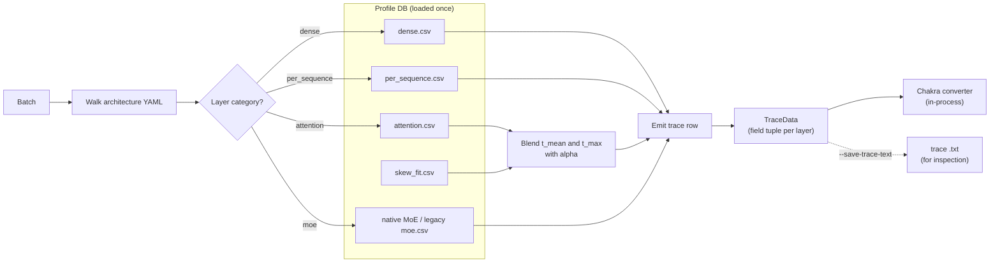

# Trace generation

`trace_generator.generate_trace(...)` is the bridge between the
**profiled latency database** (CSV files produced by the profiler)
and the **per-batch execution trace** that ASTRA-Sim consumes.

It's the page where "the model has 32 decoder blocks, each block has
qkv + attention + o_proj + mlp" turns into "this batch takes
1.78 ms".

> Looking for the trace file format spec? See
> **[Reference → Trace file format](/docs/reference/trace-format)**.
> Looking for how the profiler *produces* the latency database in the
> first place? See **[Profiler → Output bundle](/docs/profiler/output-bundle)**.
> This page is about how the simulator *consumes* it.



## The data the simulator consumes

The profiler writes per-category CSVs at:

```text
profiler/perf/<hardware>/<model>/<variant>/tp<N>/{
  dense.csv,
  per_sequence.csv,
  attention.csv,
  linear_attention.csv, # hybrid/recurrent models only
  moe_components/,   # native deployment component tables
  moe.csv,           # retained historical whole-block tables only
  skew.csv,          # if heterogeneous-decode sweep is on
  skew_fit.csv       # ditto, the fitted alpha table
}
meta.yaml
```

Where `<variant>` is the checkpoint-default label, e.g., `bf16` or
`bf16-kvfp8` or `fp8-kvfp8`. The simulator resolves it with
`resolve_variant(model_config)` — a pure function of the model config,
taking no dtype argument.

The CSVs hold `time_us` (microseconds). The simulator multiplies by
1000 and rounds to ns at load time, every internal latency is in ns.

## Loading the perf DB

`_load_perf_db(hardware, model, variant)` is called once per
unique `(hardware, model, variant)` triple over the simulator's
lifetime; results are cached in `_perf_db_cache`. Calling it on every
batch would be way too slow.

On first load, the simulator also:

1. Reads `meta.yaml` and compares the runtime's
   `--max-num-batched-tokens` and `--max-num-seqs` against the
   profiled sweep bounds. If you exceed them, you get a one-shot
   warning that lookups will **extrapolate** rather than clamp.
2. Validates and hydrates supported skew calibration from `skew_fit.csv`.
   Enabled legacy fits are rejected; rebuild with `profiler refit-skew`.

### Runtime-selected components

For a catalog with `component_layouts`, the first use at each TP validates the
recorded choice and every coupled category. Pending, stale or mixed acquisitions
fail; unmarked historical tables retain their original decomposition. Expanded
sequences are cached by TP and the original sequence or declared site/role/layer,
without mutating the shared catalog or changing latency interpolation. Per-TP
views share the authoritative lazy caches. Keep published bundles immutable while
the simulator reads them; see the [publication contract](../profiler/output-bundle#runtime-selected-component-layouts).

The packed Qwen GDN core has its own tensor-size boundary, and declared row-output
projections carry ordinary TP reductions. These are independent of profile timing;
see [packed-core traces](../examples/model-families/hybrid-linear-attention#packed-core-traces).

### Native MoE lookup reuse

Native component tables are validated on first use for each TP/DP/rank and
sequence-parallel target. The persistent perf DB owns both deployment-selection
and table caches, so per-batch views share the same interpolation structures.
TP-specific attention caps remain local to each view. Missing coverage is cached
separately from invalid data, which still raises an error. This reuse changes
host execution cost, not latency values, routing decisions or trace contents.
Restart the simulation after replacing a bundle.

### Native DSA duration replay

Native DeepSeek-V3.2 tables use site-aware sequences: a shared fused
embedding/input norm consumes only the first decoder norm, later residual norms
remain per invocation, and one uncapped attention/indexer tail replaces the
historical pair. New bundles require completed dense/head/attention categories,
separately completed native MoE components and matching
[runtime evidence](../profiler/output-bundle.md#native-dsa-acquisition).
Historical records containing whole-block MoE retain their original checks.

Only the Python trace API's explicit
`generate_trace(..., duration_replay_only=True)` admits this representation.
Default serving refuses it: the recorded native cache is 656+132 = 788 bytes per
token per layer, while the historical FP8 capacity model counts 576+132 = 708.
There is no CLI flag that silently bypasses scheduler memory admission.

Replay is local TP1/PP1/EP1 without DP, P/D transfer, offloading, PIM, speculative
decoding, prefix caching or padded eager rows. Power and roofline consumers are
rejected. Its logical byte annotations are not memory traffic or resident weights;
see the [byte boundary](../reference/trace-format.md#native-dsa-logical-bytes).
Source configuration is rechecked even on a cached byte-contract hit. The actual
native sampler route selects 4- or 8-byte returned IDs, including the final Chakra
store; no runner is forced to match a constant width.

This connects measured durations to trace/Chakra execution, not full serving
capacity, workload accuracy or another deployment. Unmarked historical bundles
keep their previous lookup, sizes and execution path.

### Native Kimi duration replay

Catalog `native_profile` selects the shared contextual bundle loader; Kimi-K3's
runtime-admitted hybrid/residual adapter connects its ordinary category tables
and original-depth AttnRes contexts to the same Python trace API. Loading checks
completed plans, independent catalog coverage, CSV hashes, semantic capture/runtime
contracts and observed native tensor layouts against the original source config.
Observed library versions and historical source hashes are provenance, not execution locks.
New bundles load category, context and callable records from the variant-root
`meta.yaml::per_tp[tp]`; timing CSVs keep their existing coordinates. Supported
historical metadata layouts have read fallbacks. Directory names locate data,
not compatible runtime semantics, and metadata relocation is not remeasurement.
A catalog or a partial CSV directory alone is not sufficient.
Native MoE completion is checked through its independent deployment contract,
including wrapper work; new bundles do not require a removed ordinary `moe.csv`
acquisition. This does not broaden the duration-only admission below.
See [native acquisition](../profiler/output-bundle#native-kimi-acquisition).

`generate_trace(..., duration_replay_only=True)` walks the supplied configuration's
decoder schedule, including its attention types and dense/routed MLP blocks. AttnRes
is selected by original layer and pre-attention/post-attention/final role, then
linearly interpolated only within that exact context's measured token range.
Other ordinary components retain their category lookup; MoE uses its independent
deployment component table. Transformer-block copying is
disabled for this representation because changing layer position changes the
residual context. The joined MLA q-LoRA component preserves concurrent branches;
KDA input projection, auxiliary projection, core and output projection are separate.

Replay requires local TP1/PP1/EP1, no DP, unpadded eager q=1 requests within the
recorded engine envelope and no prefix reuse, speculation, P/D, offloading, PIM,
power or roofline calculation. Default serving refuses this bundle: the duration
path does not provide resident-weight or hybrid-cache capacity admission, and
there is no CLI flag bypassing that requirement.

`ContextualProfileBundle` and `HybridResidualSizes` in `component_sizes.py` supply
logical input/weight/output annotations from the independent config and validated
native layouts, retaining distinct MLA and KDA dimensions. Packed expert scales
are included and the full expert tensor
axis is retained; active expert counts do not masquerade as resident weights.
Derived aliases and the actual sampler ID width are accounted for. Persistent
KV/recurrent states, routing metadata and scratch workspaces are outside these
triples. They describe component boundaries, not traffic or allocator residency.
Chakra and ASTRA replay the measured durations without treating those annotations
as a complete memory model. This integration is not a full-model GPU benchmark
or an accuracy claim for distributed serving.

Source-specific backend/ABI checks remain in force even though widths, depth,
residual capacity and expert geometry are no longer fixed to one checkpoint.
Changed publication schemas or execution semantics require fresh measurements;
historical artifacts cannot be relabeled as admitted contextual bundles.

## Per-category lookup

Each layer in the model's architecture YAML is tagged with a
**category**, including dense, per_sequence, attention, linear_attention and moe. Each category
has its own lookup function:

| Category | Lookup function | Key | Interpolation |
| --- | --- | --- | --- |
| `dense` | `_lookup_dense` | `total_len` (sum of tokens in batch) | 1D linear |
| `per_sequence` | `_lookup_per_sequence` | `num_requests` | 1D linear |
| `attention` | `_lookup_attention` | Kernel and query-length slice, then `(prefill_chunk, prefill_key, n_decode, kv_decode)` | Linear bracket + blend on the four geometry axes; missing query length selects the nearest measured slice with a warning |
| `linear_attention` | `_lookup_linear_attention` | Kernel, `(prefill_tokens, n_decode)` | Profiled grid lookup; no KV-history axis or skew correction |
| Legacy whole-block `moe` | `_lookup_moe` | EP slice, then `(local_tokens, activated_experts)` | 2D linear; a missing EP degree uses the nearest measured degree with a warning |
| Native DP+EP MoE | `MoeComponentTable.local_ns` / `expert_ns` | Deployment contract, mode and local/gathered work coordinates | Interpolation within measured feasible support; out-of-support data is rejected |

Dense and per-sequence rows use the target's effective row count after the
applicable graph/head rules, not necessarily the raw scheduled token count.
See [parallelism mechanics](./parallelism-mechanics).

`prefill_key = sum(c * (history + c / 2)) / sum(c)` weights each prefill
by its query count `c`, not by one vote per sequence. Empty prefills give zero.
Profiling and runtime use the same helper in `profiler/core/attention_shape.py`.
This preserves the continuous causal convention and does not claim that one
coordinate fully determines heterogeneous attention latency. For saturating
kernels, each effective key is capped before the weighted mean.
For new native MiniMax-M3 tables, the cap comes from the validated per-TP
[attention contract](../profiler/output-bundle.md#native-attention-lookup-contract):
2048 for the reviewed Triton BF16 sparse kernel. Unmarked historical tables
retain 2176. Dense attention, the indexer and decode-history coordinates are
unchanged. Each trace context selects its TP's cap without overwriting the
shared cached bundle; invalid or unfinished native contracts are not fallbacks.

Ordinary dense, per-sequence and attention grids can **extrapolate** beyond
measured support, reducing confidence; missing attention corners also have
nearest-cell fallbacks. Do not generalize that behavior to every category:
query lengths and legacy EP degrees select discrete slices, skew uses buckets,
and installed native MoE components reject out-of-support work. A startup
range warning is not proof that every subsequent lookup is supported.

The `time_us` value at each grid point is converted to ns at load
time, so lookups directly yield ns.

## Variant resolution

`resolve_variant(model_config)` selects the checkpoint-default profile label.
It does not select the profiler's explicit alternative variants: there is no
dtype flag on the simulator to read instead:

```
dtype           config_weight_dtype(config)
                  quantization_config.quant_method, else torch_dtype / dtype

kv_cache_dtype  config_kv_cache_dtype(config)
                  'fp8' if quantization_config declares kv_cache_scheme
                  or kv_cache_quant_algo, else 'auto'

variant         f"{short(dtype)}"                            # kv_cache_dtype == 'auto'
                f"{short(dtype)}-kv{short(kv_cache_dtype)}"  # otherwise
```

So one model config names exactly one folder:

- Llama-3.1-8B (`torch_dtype: bfloat16`) → `bf16`
- DeepSeek-V3.2-Exp (`quant_method: fp8`) → `fp8`
- a checkpoint declaring `kv_cache_scheme` → `bf16-kvfp8`

The profiler can still *write* other folders for the same model. On a quantized
checkpoint, a different floating `--dtype` adds an `-act...` suffix without
removing quantization; a matching BF16/FP16 dtype keeps the default name.
`--variant` explicitly labels an intentional alternative and `--kv-cache-dtype`
can append a KV suffix. The simulator does not automatically select these alternate
measurements. See [profiler variant naming](/docs/profiler/running#precision-and-variant-names).

If the resolved folder doesn't exist under `profiler/perf/...`, the
simulator raises a clear `FileNotFoundError` pointing at the missing
variant. Check the expected folder against the acquired bundle's configuration
and recorded engine settings. Common checkpoint defaults agree; config-specific
automatic dtype/quantization cases have [naming limitations](/docs/profiler/running#precision-and-variant-names).
Do not rename incompatible measurements merely to satisfy a lookup path.

## Heterogeneous-decode skew correction

The uniform attention grid uses one decode-history length per shot.
Heterogeneous histories can change latency, so the skew profiler measures
those batches separately. The default offline compiler fits corrections
against the same mean/max **lookup references** that serving will use:

```text
t_attention = t_mean_lookup + alpha * (t_max_lookup - t_mean_lookup)
```

The ordinary attention table, interpolation and query-weighted prefill
coordinate are unchanged. Pure prefill, one decode or uniform decode bypass
skew correction. For heterogeneous decode, both endpoints are needed to
compute the lever before choosing alpha, even when that alpha is zero.

New fits partition by kernel, decode query length, prefill-token bucket and
relative endpoint gap `lev = (t_max - t_mean) / t_mean`. Within a partition,
only sufficiently supported measured N values become anchors. Runtime picks
the nearest anchor on a log scale; exact midpoint ties go to the smaller N.
There is no interpolation between alpha cells.

N is support-adaptive; prefill boundaries scale with the measured envelope,
while leverage boundaries are dimensionless. They are stored in
metadata. Missing cells or out-of-range N use the same kernel/query pooled
fallback. A missing kernel/query fit means zero correction. There is no
model-specific fallback selection.

At profile load time, serving checks the bundle identity, attention and
fitted-table checksums, reference lookup fingerprint and saturation semantics.
A stale fit raises with instructions to run `profiler refit-skew`. After
loading, lookup is an in-memory partition selection and binary search;
it never refits or searches raw measurements in the simulation loop.

Enabled fits without a recognized calibration format require rebuilding;
The current accepted format is `runtime-skew-calibration`.
Disabled bundles are unchanged. Skipping skew
acquisition does not remove an existing calibration; a bundle with no enabled
fit uses zero correction. Neither endpoint reduction nor these empirical
buckets uniquely describe all request distributions, so validate changes
against all reported `bench/examples` statistics.

See [Profiler → Skew & alpha fit](/docs/profiler/skew-alpha-fit) for the
weighted-median objective, data contract, CPU-only rebuild and limitations.

## Walking the architecture YAML

Each model has an architecture YAML at
`profiler/models/<model_type>.yaml` — or at a YAML that lists its
`model_type` under `model_types:`, since one file serves a whole family
(e.g., `llama.yaml`, `qwen3.yaml` for both `qwen3` and `qwen3_moe`). The YAML
has:

- A `catalog:` mapping canonical layer names (e.g., `qkv_proj`,
  `attention`, `moe`) to classes, CUDA kernels or exact native operator scopes.
- A `blocks:` describing what one decoder layer emits, keyed by axis, plus a
  `shared:` for what runs once per iteration:
  `shared.prologue → (attn.<type>.pre_attn → attn.<type>.post_attn →
  mlp.<dense|moe>) x num_hidden_layers → shared.head`.

Which block a given layer runs comes from the **checkpoint's own config**, not
from the YAML: `layer_types` decides the attention, `first_k_dense_replace` /
`decoder_sparse_step` / `moe_layer_freq` the MLP, `sparse_attention_freq` /
`index_topk_pattern` whether a sparse-selection branch applies.
`profiler/core/stack.py` owns those rules and both the profiler and the
simulator read it, so the two cannot disagree about a hybrid stack.

Blocks are built once per distinct block *shape* and replayed for every layer
that shares it, so trace generation stays O(1) in depth for a uniform model
while a heterogeneous one still gets the right block per layer.

`trace_generator._emit_sequence` walks a block's layer list and emits
one trace row per layer. It also:

- Attaches **TP-ALLREDUCE** after `o_proj`, `down_proj` and declared
  `tp_output_reduction: all_reduce` projections when `tp_size > 1`.
  The ordinary shared target embedding also reduces once per
  forward; the shared logits head all-gathers vocabulary shards before
  sampling. Catalog bindings guard these endpoint collectives. Per-sequence
  tensor sizes use the head's lookup row count rather than total prompt tokens.
  See [parallelism mechanics](./parallelism-mechanics) for payload conventions.
- Wraps the MoE block with the **EP all-to-all** markers when MoE is
  active — emitted as `ALLGATHER` (dispatch) and `REDUCESCATTER`
  (combine), matching vLLM's default `allgather_reducescatter` backend.
- Swaps in PIM attention before the NPU attention kernel when
  `--enable-attn-offloading` is on.
- One-shot-warns when a sequence layer is missing from the profile
  CSVs (so you know to extend the profile).

## Where DP groups change things

When instances are in a `dp_group`, trace generation is **deferred**
until all DP members have scheduled their batches for the current iteration.
It first resolves each member's local graph mode and padded forward rows, then
coordinates the common DP mode. A non-NONE common mode shares the largest
locally padded count; NONE retains each member's local count. The complete
resulting vector is passed to MoE geometry, including per-member ceil division
for sequence-parallel wrappers.

Native MoE separates local gate/finalization rows from gathered expert rows and
emits hidden-state, top-k-weight and top-k-ID AllGathers separately. The legacy
whole-block fallback retains a combined hidden-state/router-logit approximation.
Their ragged Ring payloads follow the formulas in the parallelism guide; neither
uses `max(total_len) / ep_total` as a universal dispatch size.

Padded forward rows affect dense computation, but do not create requests or
attention queries. Attention query/KV geometry and non-speculative head rows
remain tied to actual scheduled work. Idle DP members participate in backbone
and expert collectives without producing logits or sampled tokens.

The full DP+EP wave-sync mechanics live on
**[Parallelism mechanics](./parallelism-mechanics)**.

## Block copy optimization

With deterministic routing, layers with the same resolved block and site
sequence produce identical trace rows. Rows carry canonical names, and the
writer numbers the lines, so rebuilding each layer is unnecessary. By default
`enable_block_copy=True`:

- **Build** a block's rows once per distinct block shape.
- Append that same list once per layer sharing the shape.

For these deterministic cases, the emitted trace is unchanged and still has
every layer's rows. This is a
trace-*generation* optimization, saving the per-layer latency lookups and size
computations, and there is no `block_copy` instruction in the trace or in
Chakra. Row count depends on the active component and communication path.

The reuse key includes the layer's resolved block shape and, for site-aware
catalogs, its resolved component sequences. A heterogeneous stack gets a block
per key rather than one for the whole model — Qwen3.5's gated-DeltaNet and
full-attention layers are never shared. Contextual profiles disable copying.

Exact for dense models and deterministic MoE routing at a fixed batch shape.
RR advances token positions but resets at each layer invocation, so block copy
is exact for it too. RAND reuses a draw and suppresses per-layer variation;
use `--no-enable-block-copy` when that variation matters. Custom policies with
layer-dependent variation need separate checks; do not assume suppressing it
is harmless merely because a batch is large.

## Per-rank latency for MoE

MoE uses `EXPERT {i}` / `EXPERT END` markers. Native execution emits rank-local
gate/routing, expert and finalization regions with collectives between them.
It selects a TP/DP/EP/rank contract and uses local rows for gate/finalization,
gathered rows, active experts and local assignments for new expert tables.
Historical component tables retain their balanced-total lookup. Legacy lookup instead reads
the whole-block EP slice from `moe.csv`, using gathered or replicated input
rows, not the router's unique local-token estimate.

The capability-admitted live TP1/DP1/EP1 path emits gate/routing, experts and
wrapper rows without collectives. It preserves native quantized expert execution
and accounts for shared experts and latent transforms in the wrapper. Recorded
gate dtype and physical expert width determine their distinct byte annotations.
These rows sum unique CUDA activity durations; a serial trace does not reproduce
native overlap between branches, and wrapper work can occur both before and after
the routed call. This is not an elapsed critical-path latency claim.
Missing matching components can fall back only when historical whole-block data
exists. Fresh bundles with missing or incomplete components fail explicitly.

DP members index their own global expert ranks while trace markers remain
instance-local. Ranks execute in parallel and synchronize at their collectives;
Chakra preserves dependencies across every collective and skipped expert region.

Native expert-to-rank assignment uses contiguous vLLM ownership, assigning
remainder experts to the first ranks. The legacy whole-block path retains
`expert_id * ep_size // num_experts`; these agree when EP divides the expert count.

## Gotchas

1. **`time_us` in CSV is microseconds.** The simulator converts to
   ns at load time. If you're cross-referencing a CSV row against
   a simulator log line, multiply by 1000.
2. **No calibration scaling.** Profiled latencies are used directly,
   not rescaled. If your profiles look off, re-profile rather than
   tweaking a "scale factor", there isn't one.
3. **First-load is slow** (perf DB parsing); subsequent loads hit
   `_perf_db_cache`. Restarting the simulator pays the parse cost
   again.
4. **Variant folder must exist.** A model config whose bundle was never
   profiled → `FileNotFoundError`. The profiler's defaults name the same
   folder the simulator asks for, so profiling the model is the fix.
5. **Skew requires a valid enabled calibration.** Disabled bundles bypass it.
   An unsupported cell uses the matching kernel/query pooled fallback; missing
   kernel/query data means zero correction. A pooled estimate has no general
   accuracy guarantee, and stale enabled tables are rejected.

## What's next

- **[Parallelism mechanics](./parallelism-mechanics)**: what
  TP-ALLREDUCE and the EP all-to-all actually look like in the trace.
- **[Reference → Trace file format](/docs/reference/trace-format)**
  the field-by-field spec of the text trace this page produces.
